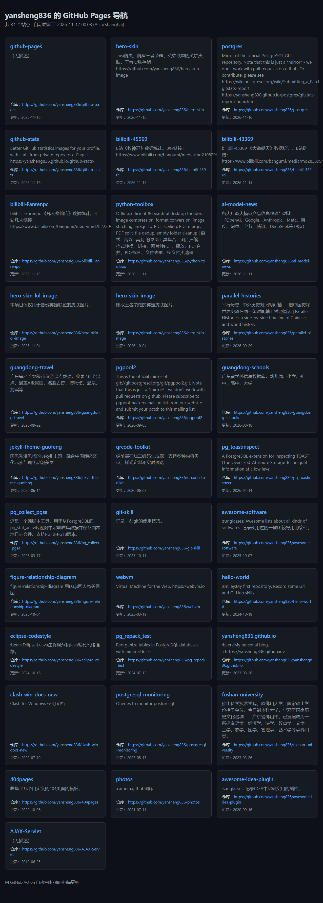

# github-pages

> Auto-generated navigation page listing all your GitHub Pages sites in a clean card grid.

[English](README.md) · [简体中文](README.zh-CN.md)

[](https://github.com/yansheng836/github-pages/actions/workflows/update-nav.yml)
[](LICENSE)
[](https://www.python.org/)
[](https://github.com/yansheng836/github-pages/stargazers)



A single Python script (standard library only) scans every public repo under your
GitHub account, keeps the ones that have GitHub Pages enabled, and renders a dark,
responsive card-grid navigation page. A scheduled GitHub Action regenerates it daily
and pushes the result to your Pages site — no server, no database, no dependencies.

**Live demo:** <https://yansheng836.github.io/github-pages/>

## Features

- **Zero dependencies** — pure Python 3.12 standard library.
- **Fully automatic** — a daily GitHub Action scans, rebuilds, and publishes.
- **One file output** — a self-contained `index.html` hosted on GitHub Pages.
- **Per-account avatar favicon** — your GitHub avatar is injected as the site favicon.
- **Configurable timezone** — timestamps render in your local timezone (defaults to Beijing).
- **Sorted by recent activity** — the most recently pushed repos float to the top.

## Quick start (use it for your own account)

1. **Fork** this repository.
2. Enable **Settings → Pages → Deploy from a branch** (`main` / root), so the generated
   `index.html` gets served.
3. In **Settings → Actions → Allow all actions and workflows**, enable Actions.
   On forks, **scheduled workflows are disabled by default** — go to the **Actions** tab,
   click **"I understand my workflows, go ahead and enable them"**, then select the
   "更新 Pages 导航" workflow and click **Run workflow** once to generate your page.

The workflow then runs daily (UTC 00:00) and on every push to `main`, regenerating
`index.html` with **your** account's repos. The `GITHUB_TOKEN` provided by the runner
is enough — no extra secrets required. Your page lives at
`https://<you>.github.io/github-pages/`.

> The script determines the owner from `GITHUB_REPOSITORY_OWNER` (set automatically on
> GitHub Actions to whoever owns the running repo). To override, set the `OWNER`
> environment variable. No account name is hardcoded anywhere in the script.

## How it works

1. `generate_nav.py` lists every public repo under the owner via the GitHub REST API.
2. It queries `/repos/{owner}/{repo}/pages` for each, keeping only the ones with Pages enabled.
3. It collects the repo name, description, repo link, Pages URL, and last push time.
4. It renders a card-grid `index.html` sorted by most recent activity.

The GitHub Action runs this daily, commits the new `index.html`, and pushes it; Pages
serves the updated page shortly after.

## Local run

```bash
# Optional: provide a token to raise the API rate limit
export GITHUB_TOKEN=$(gh auth token)

# Generate index.html for any account
OWNER=yansheng836 python generate_nav.py
```

The generated file is written next to the script as `index.html`.

### Environment variables

| Variable                  | Required | Description                                                         |
| ------------------------- | -------- | ------------------------------------------------------------------- |
| `OWNER`                   | no       | GitHub account to scan. Falls back to `GITHUB_REPOSITORY_OWNER`.    |
| `GITHUB_TOKEN` / `GH_PAT` | no       | Token for higher API rate limits. Auto-set on GitHub Actions.        |
| `TIMEZONE`                | no       | IANA timezone for the "updated at" stamp. Defaults to `Asia/Shanghai`. |
| `LANG`                    | no       | UI language of the generated page. `en` for English, otherwise Chinese. |

## Project structure

```text
github-pages/
├── generate_nav.py          # Scan + render script (stdlib only)
├── index.html               # Generated nav page (auto-committed)
├── requirements.txt         # Empty — stdlib only, for scanner compatibility
├── docs/
│   └── screenshot.png       # Preview screenshot
├── .github/
│   ├── workflows/
│   │   └── update-nav.yml   # Daily update workflow
│   └── dependabot.yml       # Keep action versions current
├── README.md                # English docs (this file)
├── README.zh-CN.md          # Chinese docs
└── LICENSE
```

## Contributing

Contributions are welcome! See [CONTRIBUTING.md](CONTRIBUTING.md) for guidelines, and
please read the [Code of Conduct](CODE_OF_CONDUCT.md) before participating.

## License

[MIT](LICENSE) © yansheng836
