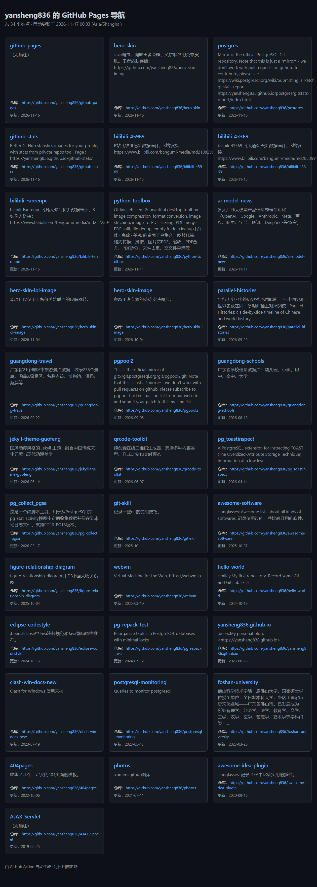

# github-pages

> 自动收集账号下所有启用了 GitHub Pages 的公开仓库，生成一个导航页面。

[English](README.md) · [简体中文](README.zh-CN.md)

[](https://github.com/yansheng836/github-pages/actions/workflows/update-nav.yml)
[](LICENSE)
[](https://www.python.org/)
[](https://github.com/yansheng836/github-pages/stargazers)



一个纯 Python 标准库脚本，扫描你 GitHub 账号下的所有公开仓库，筛出启用了
GitHub Pages 的，渲染成深色响应式卡片网格导航页。GitHub Action 每天定时重新生成并
推送到你的 Pages 站点 —— 无服务器、无数据库、无第三方依赖。

**在线演示:** <https://yansheng836.github.io/github-pages/>

## 特性

- **零依赖** —— 仅用 Python 3.9+ 标准库。
- **全自动** —— 每日 GitHub Action 扫描、重建并发布。
- **单文件输出** —— 一个自包含的 `index.html`，由 GitHub Pages 托管。
- **头像即 favicon** —— 自动把账号头像注入为站点图标。
- **可配置时区** —— 时间戳按你的时区显示（默认北京时间）。
- **按最近活动排序** —— 最近推送的仓库排在前面。

## 快速开始（用你自己的账号）

1. **Fork** 本仓库。
2. 在 **Settings → Pages** 选择从 `main` 分支根目录部署，生成的 `index.html` 即可被访问。
3. 在 **Settings → Actions** 允许所有 Action 与工作流。**fork 仓库的定时任务默认是关闭的**，
   需到 **Actions** 页点击 **"I understand my workflows, go ahead and enable them"** 启用，
   再选中「更新 Pages 导航」工作流手动 **Run workflow** 一次以生成你的页面。

之后工作流每日（UTC 00:00）以及每次推送到 `main` 时都会重新生成 `index.html`，
扫描的是**你的**账号下的仓库。运行器自带的 `GITHUB_TOKEN` 已足够，无需额外密钥。
你的导航页地址：`https://<你的用户名>.github.io/github-pages/`。

> 脚本通过 `GITHUB_REPOSITORY_OWNER`（GitHub Actions 自动注入，值为运行仓库的拥有者）
> 确定扫描账号。需要覆盖时设置 `OWNER` 环境变量。脚本中没有任何账号名是写死的。

## 工作原理

1. `generate_nav.py` 通过 GitHub REST API 列出账号下的所有公开仓库。
2. 逐个查询 `/repos/{owner}/{repo}/pages`，筛出启用了 Pages 的。
3. 收集仓库名、描述、仓库链接、Pages 站点链接、创建时间、前 3 个主要语言（按代码量，
   来自 `/repos/{owner}/{repo}/languages`）和最近推送时间。
4. 渲染成按最近活动排序的卡片网格 `index.html`。

GitHub Action 每天运行一次，提交新的 `index.html` 并推送，Pages 随之更新。

## 本地运行

```bash
# 可选：提供 token 以提高 API 速率限制
export GITHUB_TOKEN=$(gh auth token)

# 为任意账号生成 index.html
OWNER=yansheng836 python generate_nav.py

# 本地预览时不覆盖仓库里受版本控制的 index.html
OWNER=yansheng836 python generate_nav.py --out index.local.html
```

默认生成到脚本同目录下的 `index.html`；指定 `--out <路径>` 时写到该路径。

### 环境变量

| 变量名                     | 必填 | 说明                                                          |
| -------------------------- | ---- | ------------------------------------------------------------- |
| `OWNER`                    | 否   | 要扫描的 GitHub 账号。默认取 `GITHUB_REPOSITORY_OWNER`。      |
| `GITHUB_TOKEN` / `GH_PAT`  | 否   | 用于提高 API 速率限制。GitHub Actions 上自动注入。            |
| `TIMEZONE`                 | 否   | 「更新时间」使用的 IANA 时区。默认 `Asia/Shanghai`。          |
| `LANG`                     | 否   | 生成页面的界面语言。`en` 为英文，否则为中文。                 |

## 项目结构

```text
github-pages/
├── generate_nav.py          # 扫描并生成导航的脚本（仅标准库）
├── index.html               # 脚本生成的导航页（自动提交）
├── requirements.txt         # 空 —— 仅标准库，供依赖扫描器识别
├── docs/
│   └── screenshot.png       # 预览截图
├── .github/
│   ├── workflows/
│   │   └── update-nav.yml   # 定时更新工作流
│   └── dependabot.yml       # 自动升级 action 版本
├── README.md                # 英文文档
├── README.zh-CN.md          # 中文文档（本文件）
└── LICENSE
```

## 维护仓库信息

导航页显示的「描述」直接取自 GitHub 仓库的 description 字段。要修改某个仓库在
导航页上的描述，去该仓库的 **Settings → About** 改描述即可，下次 Action 运行后
自动同步。

## 参与贡献

欢迎贡献！请阅读 [CONTRIBUTING.md](CONTRIBUTING.md) 了解指引，并在参与前阅读
[行为准则](CODE_OF_CONDUCT.md)。

## 许可证

[MIT](LICENSE) © yansheng836
